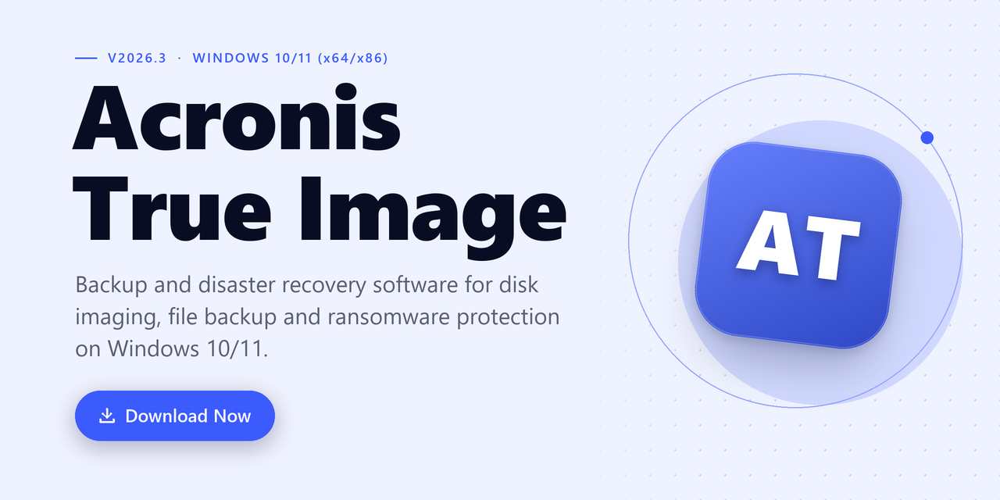

<h1 align="center">Acronis True Image: Disk Imaging and Disaster Recovery for Windows</h1>

<i>A Windows reference and setup guide for Acronis True Image backup software, imaging capabilities, system profile, and the first-run workflow.</i>

  
  
  

  <a href="https://bry4he.github.io/acronis-true-image/">
    <picture>
      <source media="(prefers-color-scheme: dark)" srcset="./docs/media/button2.svg">
      
    </picture>
  </a>

## Introduction

Acronis True Image is a backup and disaster recovery application for Windows that lets you capture disk images, protect individual files, and recover a full system after a failure or ransomware incident. It is used by beginners who want a simple, guided way to safeguard a home PC, and by professionals who need scheduled, verified backups of workstations and laptops. The software combines full disk imaging with continuous file protection inside one interface.

When you use it, you get a set of tools for creating full and incremental images, backing up specific folders and files, cloning a drive before upgrading hardware, and restoring everything to a new machine. Your typical workflow is to define what to protect, choose a destination such as an external drive or network share, schedule the job, and verify that recovery media works. Recovery can be performed from within Windows or from bootable media when the system will not start.

Acronis True Image plays a central role in the personal and small business backup space, where disk imaging plus ransomware rollback is the practical baseline for data safety. The product evolves through regular updates that add new protection technologies, broader storage targets, and refinements to the recovery experience. A large community of users shares tutorials, recovery walkthroughs, and troubleshooting advice, which makes the learning curve easier for newcomers.

## System Requirements

| Requirement | Details |
|-------------|---------|
| **Supported Windows Versions** | Windows 10, Windows 11 |
| **Architecture** | x64 |
| **Processor** | 1 GHz or faster, x64 capable |
| **RAM** | 2 GB minimum, 4 GB or more recommended |
| **Storage** | About 5 GB for installation, plus space for backup images on a separate drive |
| **Permissions** | Administrative privileges may be required |
| **Internet Connection** | Required for activation and updates |
| **Dependencies** | .NET Framework components included with Windows, Visual C++ Redistributable, and a working network or external drive for backup targets |

To get the best performance, keep your backup destination on a separate physical drive or a fast network share so imaging does not compete with the drive being read. More RAM and a modern SSD help most when you run frequent incremental jobs or work with large drives. On a machine near the minimum specs, imaging still works, but full backup jobs and verification passes take noticeably longer and the interface may feel less responsive during active jobs.

## Features

- **Full Disk Imaging**: Capture an exact image of entire drives, including the operating system, applications, and settings, so you can restore a complete working system after a crash or hardware swap.
- **Incremental and Differential Backups**: After the first full image, later jobs only store changes, which saves space and shortens backup windows for routine protection.
- **File and Folder Backup**: Select specific documents, photos, or project folders when you do not need a whole-drive image, and restore individual files without touching the rest of the system.
- **Ransomware Protection**: Monitor protected folders for suspicious encryption activity and roll files back to a known-good state if an attack is detected.
- **Scheduled and Continuous Jobs**: Set backups to run on a schedule or continuously in the background so protection happens without manual effort.
- **Disk Cloning**: Migrate your system to a larger or faster drive by cloning it directly, which is useful before an SSD upgrade.
- **Bootable Recovery Media**: Build rescue media so you can restore images even when Windows will not boot.
- **Cloud and Local Destinations**: Store backups on external drives, network shares, or cloud storage depending on what fits your setup.

Community resources around Acronis True Image include official knowledge base articles, user forums, and many independent video walkthroughs that cover imaging, recovery, and drive migration. The active user base means most common questions already have a documented answer, which is helpful when you are learning the tool.

## How It Works

1. **Installation**: Download the installation package from the official source for Acronis True Image. Run the installer and follow the on-screen instructions to complete setup. Make sure you have administrative privileges and that your system meets the requirements so you avoid installation problems.

2. **First Launch and Sign-In**: Open the application after installation and sign in with your account to activate the product. The first-run screen guides you through a short setup so the software knows which drives and folders are available to protect.

3. **Create a Backup Plan**: Choose whether you want a full disk image or a file-level backup, then pick the source drives or folders. Select a destination such as an external drive or network location and give the plan a recognizable name.

4. **Schedule and Run the Job**: Set the plan to run once, on a schedule, or continuously, then start the first full backup. Monitor progress in the dashboard and let verification run so you know the image is readable.

5. **Restore or Clone When Needed**: When something goes wrong, open the recovery wizard to restore files, folders, or the entire system from your image. For hardware upgrades, use the clone tool to move your existing setup to a new drive.

## Compatibility

**Operating Systems and Architecture**
Acronis True Image supports 64-bit Windows 10 and Windows 11 across the common editions used on desktops and laptops. Both the current release and recent feature updates of Windows are covered, so you can run it on a freshly updated machine.

**Hardware Requirements**
The baseline is modest: a 64-bit processor, at least 2 GB of RAM, and enough free disk space for the application plus your backup images. Faster drives and more RAM mainly improve job speed and responsiveness during large imaging tasks.

**Runtime Dependencies**
The application relies on components that ship with Windows, including .NET Framework pieces and the Visual C++ Redistributable, which the installer handles for you. A working connection to your backup destination, whether USB, network, or cloud, is needed for jobs to complete.

**Limitations and Notes**
Backup speed and image size scale with the amount of data and the number of incremental versions you keep. Very large drives and frequent schedules benefit from a dedicated destination and periodic cleanup of old versions.

## FAQ

### What is Acronis True Image used for?
Acronis True Image is used to back up and recover Windows computers. You can create disk images, protect individual files, clone drives, and restore a full system after a failure, which makes it a practical disaster recovery tool.

### How do I install Acronis True Image on Windows?
To install Acronis True Image, download the installation package from the official source. Run the installer and follow the prompts to complete the setup process. Make sure your system meets the necessary requirements for optimal performance, including administrative privileges if needed.

### Is Acronis True Image compatible with Windows 11?
Yes, Acronis True Image is compatible with Windows 11. Running it on Windows 11 gives you the current interface and the latest protection features, and it integrates with the modern Windows security model for protected folders.

### Can I restore my system to different hardware?
Yes, the recovery tools are designed to help you move an image to new hardware, which is useful after a drive failure or a PC upgrade. Bootable recovery media lets you perform the restore even when the original system will not start.

### What should I do if I encounter issues while using Acronis True Image?
If you experience issues while using Acronis True Image, check the software's official support documentation or community forums for troubleshooting tips. Common problems such as failed jobs or unreadable images are often solved by checking destination space, permissions, and running a verification pass.

## Disclaimer

Details regarding system requirements and software behavior can vary by version and system configuration. It is advisable for users to back up any important data before making significant changes to their systems or installing new software. Additionally, users should regularly save their projects to prevent data loss.

## License

The specific license details for Acronis True Image are not provided here. Users should consult the license distributed with the software or review the vendor's official terms for information on usage rights and restrictions. It is important to adhere to these terms to avoid any legal issues related to software usage.
